# Redis 직접 구현 — 단계별 개발 계획

- **작성일**: 2026-10-25
- **근거 문서**: `docs/architecture/2026-10-18-redis-implementation-design.md` (설계·로드맵), `docs/summary/2026-10-18-redis-event-loop-qna-summary.md` (event loop 분석)
- **목적**: 설계 문서의 Phase 1~5를 "검증 가능한 완료 기준"이 있는 작업 단위로 구체화한다.

## 0. 전제 및 결정 필요 사항

설계 문서 `열린 질문`(L142~147)에 남아 있던 항목을 아래와 같이 **잠정 결정**한다. 이견이 있으면 해당 Phase 착수 전에 변경한다.

| 항목 | 잠정 결정 | 근거 / 트레이드오프 |
|------|-----------|---------------------|
| 구현 언어 | **Go** | 설계 문서 추천안. GC pause는 학습 목적상 허용 |
| 이벤트 루프 방식 | **2단계 접근**: (1) goroutine-per-conn + **단일 executor goroutine** → (2) Phase 6에서 `kqueue`/`epoll` 직접 사용 루프로 교체 | Go `net`은 내부적으로 epoll을 숨겨 event loop 학습 효과가 없음. 먼저 동작하는 서버를 만들고, 이후 교체해 비교 |
| listpack | **초기엔 Go 기본 자료구조로 대체**, Phase 7에서 직접 구현 | 인터페이스(`Encoding`)만 먼저 분리해 두면 교체 비용 낮음 |
| RDB의 `fork()` 대체 | 스냅샷 시점에 **executor가 DB를 얕은 복제(또는 COW 맵)** 후 별도 goroutine이 직렬화 | Go에서 `fork()` 비권장. 복제 비용(메모리 2배, 일시 정지)은 Redis와의 차이점으로 문서화 |
| AOF rewrite 중 신규 쓰기 | **rewrite 버퍼에 누적 → 완료 시 append 후 파일 교체** | Redis의 rewrite buffer 방식과 동일 |
| 호환성 목표 | `redis-cli`, `redis-benchmark` 로 접속 가능 (RESP2) | RESP3은 범위 제외 |
| 테스트 | 각 Phase마다 단위 테스트 + 실제 `redis-cli` 통합 확인 | 전역 지침 4번(검증 가능한 목표) |

> ⚠️ 확인 필요: 리포지토리가 현재 문서 전용(`docs/`만 존재)이므로 코드 위치(별도 리포 vs 이 리포 하위 디렉터리)를 정해야 한다. 아래 계획은 `redis-go/` 별도 모듈 기준으로 작성했다.

## 1. 전체 로드맵

```mermaid
gantt
    title Redis 직접 구현 로드맵 (예상 소요, 주 단위)
    dateFormat  X
    axisFormat  %s주
    section 기반
    Phase 0 프로젝트 셋업          :p0, 0, 1
    Phase 1 뼈대 (TCP/RESP/GET·SET) :p1, after p0, 2
    section 코어
    Phase 2 자료구조               :p2, after p1, 3
    Phase 3 TTL / Expiry           :p3, after p2, 1
    section 영속성
    Phase 4 RDB / AOF              :p4, after p3, 3
    section 심화
    Phase 5 Eviction/PubSub/TX     :p5, after p4, 3
    Phase 6 Event Loop 교체        :p6, after p5, 2
    Phase 7 listpack 등 인코딩 최적화 :p7, after p6, 2
```



> 소요 기간은 주 5~10시간 투입 가정의 대략치이며 근거 데이터는 없다. 일정 압박이 아닌 순서 참고용.

## 2. Phase별 상세 계획

### Phase 0. 프로젝트 셋업

| 작업 | 완료 기준 |
|------|-----------|
| Go 모듈 초기화, 디렉터리 레이어 분리 | 설계 문서 5개 레이어와 1:1 대응되는 패키지 존재 |
| CI 대용 `make test` / `make bench` 타깃 | 빈 테스트가 통과 |
| 패키지 구조 확정 | 아래 구조 참고 |

```
redis-go/
  cmd/server/main.go
  internal/
    network/      # 1. TCP 서버, (추후) event loop
    protocol/     # 2. RESP parser/writer
    command/      # 3. dispatcher, command table
    store/        # 4. db, object types, expiry
    persist/      # 5. rdb, aof
```

의존 방향은 `network → protocol → command → store → persist` 단방향으로 유지한다.

### Phase 1. 뼈대 (TCP + RESP + GET/SET/DEL)

| # | 작업 | 검증 |
|---|------|------|
| 1-1 | RESP2 파서: Simple String, Error, Integer, Bulk String, Array | 단위 테스트: 정상 케이스 + 불완전 입력(TCP 분할 수신) + 잘못된 프로토콜 |
| 1-2 | RESP writer | 파서와 round-trip 테스트 |
| 1-3 | TCP 서버 (conn당 goroutine) + **명령 실행은 단일 executor goroutine** 채널로 직렬화 | `-race` 로 동시 클라이언트 100개 테스트 통과 |
| 1-4 | Command table + dispatcher: `PING`, `ECHO`, `GET`, `SET`, `DEL`, `EXISTS` | 알 수 없는 명령 시 `-ERR unknown command` 반환 |
| 1-5 | in-memory `map[string]*Object` | — |

**Phase 1 완료 기준**: `redis-cli -p <port>` 로 접속해 `SET k v` → `GET k` 가 동작하고, `redis-benchmark -t set,get -q` 가 에러 없이 완주한다.

**핵심 학습 포인트**: TCP는 스트림이므로 메시지 경계가 없다 → 파서는 반드시 "부분 수신" 상태를 처리해야 함 (`readQueryFromClient`의 query buffer 역할).

### Phase 2. 자료구조 (List / Hash / Set / ZSet)

각 타입은 `Object{type, encoding, ptr}` 구조(Redis `robj`와 동일 개념) 위에 구현한다. 이 단계에서 `WRONGTYPE` 에러 처리도 함께 만든다.

| 순서 | 타입 | 명령 | 내부 구조 (초기) | 완료 기준 |
|------|------|------|------------------|-----------|
| 2-1 | String 보강 | `INCR/DECR/APPEND/MGET/MSET/SETNX` | `[]byte`, int 인코딩 | 정수 오버플로 에러 테스트 |
| 2-2 | List | `LPUSH/RPUSH/LPOP/RPOP/LRANGE/LLEN` | 양방향 연결 리스트 | 음수 인덱스 `LRANGE 0 -1` 테스트 |
| 2-3 | Hash | `HSET/HGET/HDEL/HGETALL/HLEN` | `map` | — |
| 2-4 | Set | `SADD/SREM/SMEMBERS/SISMEMBER/SINTER` | `map[string]struct{}` | 교집합 결과 정확성 |
| 2-5 | ZSet | `ZADD/ZSCORE/ZRANGE/ZRANGEBYSCORE/ZREM` | **Skip List + map** (이중 구조) | 동일 score 시 member 사전순 정렬, 대량 랜덤 삽입 후 정합성 property test |

**Phase 2 완료 기준**: 타입별 명령이 `redis-cli`에서 실제 Redis와 동일한 응답을 한다 (실제 Redis를 띄워 **응답 비교 테스트**; 설치 가능 여부는 ⚠️ 확인 필요).

**핵심 학습 포인트**: ZSet이 Skip List와 Hash를 함께 유지하는 이유(설계 문서 L76~81)를 `ZSCORE` O(1) vs `ZRANGEBYSCORE` O(log N) 벤치마크로 직접 확인.

### Phase 3. TTL / Expiry

| # | 작업 | 검증 |
|---|------|------|
| 3-1 | `expires` 맵 분리 (key → 만료 시각 ms) | — |
| 3-2 | 명령: `EXPIRE/PEXPIRE/TTL/PTTL/PERSIST`, `SET ... EX/PX/NX/XX` | 반환값(-1, -2) 규격 일치 |
| 3-3 | **Lazy expiry**: 모든 키 접근 경로에서 만료 검사 | 시계를 주입(`Clock` 인터페이스)해 sleep 없이 테스트 |
| 3-4 | **Periodic active expiry**: 100ms 주기, 20개 샘플, 25% 초과 시 반복 (설계 문서 L67~74) | 접근 없는 만료 키가 일정 시간 후 메모리에서 제거됨 |
| 3-5 | 활성 만료의 시간 상한 (루프가 executor를 독점하지 않도록) | 만료 키 100만 개 상황에서 명령 응답 지연 측정 |

**핵심 학습 포인트**: 활성 만료가 단일 스레드 executor를 막지 않도록 **시간 예산**을 두는 이유.

### Phase 4. 영속성 (RDB / AOF)

#### 4-A. AOF (먼저 구현 — 더 단순)

| # | 작업 | 검증 |
|---|------|------|
| 4-1 | 쓰기 명령 RESP 그대로 append | 서버 재시작 후 데이터 복원 |
| 4-2 | `appendfsync` 정책: `always` / `everysec` / `no` | 정책별 처리량 벤치마크 비교표 작성 |
| 4-3 | 로드 시 파일 말단 손상(잘린 명령) 처리 | 파일을 임의 바이트에서 자른 테스트 |
| 4-4 | 만료 키는 `PEXPIREAT` 절대 시각으로 기록 | 재시작 후 TTL 정확성 |
| 4-5 | `BGREWRITEAOF`: 현재 DB를 최소 명령으로 재생성, 진행 중 쓰기는 rewrite 버퍼에 누적 후 반영 | rewrite 중 쓰기 부하를 줘도 데이터 유실 없음 |

#### 4-B. RDB

| # | 작업 | 검증 |
|---|------|------|
| 4-6 | 자체 바이너리 포맷 정의 (매직, 버전, 타입별 직렬화, 체크섬) | round-trip 테스트 |
| 4-7 | `SAVE` (동기) | 저장 → 재시작 → 동일 |
| 4-8 | `BGSAVE` (fork 대체: 복제 후 별도 goroutine 직렬화) | 저장 중에도 명령 응답 지속, 스냅샷 일관성(저장 시점 상태) 보장 |
| 4-9 | 시작 시 로드 우선순위: AOF 있으면 AOF, 없으면 RDB | — |

> 실제 Redis RDB 바이너리 호환은 목표가 아님. 필요하면 별도 후속 과제로 분리한다.

**Phase 4 완료 기준**: `kill -9` 후 재시작 시 AOF `everysec` 기준 약 1초 이내 손실만 발생함을 테스트로 입증한다.

### Phase 5. 심화 기능

| 순서 | 기능 | 핵심 설계 | 검증 |
|------|------|-----------|------|
| 5-1 | Pipeline | 한 번에 읽은 여러 명령을 순차 처리 후 응답 일괄 flush | `redis-benchmark -P 16` 처리량이 비파이프라인 대비 향상 |
| 5-2 | MULTI/EXEC/DISCARD (`WATCH` 는 선택) | 클라이언트별 큐잉, executor에서 EXEC 시 일괄 실행 → 원자성 | EXEC 중간에 다른 클라이언트 명령이 끼어들지 않음 |
| 5-3 | Pub/Sub | 채널→구독자 맵, 구독 모드 클라이언트 제약 | 다중 구독자 팬아웃, 느린 구독자 처리 방안 결정 |
| 5-4 | `maxmemory` + Eviction (`allkeys-lru`, `allkeys-lfu`) | **근사 LRU**: 무작위 샘플(기본 5개) 중 가장 오래된 키 제거 | 정확한 LRU 대비 적중률 비교 실험 |

### Phase 6. Event Loop 교체 (설계 문서 핵심 학습 목표)

`docs/summary/2026-10-18-redis-event-loop-qna-summary.md` 의 분석을 직접 구현으로 검증하는 단계.

| # | 작업 | 검증 |
|---|------|------|
| 6-1 | `EventLoop` 인터페이스 추출 (`Poll`, `AddEvent`, `DelEvent`) — Redis `ae.c` 추상화에 대응 | 기존 goroutine 방식을 구현체 1로 감싸도 모든 테스트 통과 |
| 6-2 | `syscall` 기반 **kqueue(macOS) / epoll(Linux)** 구현체 (build tag 분리) | 동일 테스트 스위트 통과 |
| 6-3 | non-blocking 소켓 + 클라이언트별 query/output buffer, 쓰기 가능 이벤트 처리 | 느린 클라이언트가 다른 클라이언트를 막지 않음 |
| 6-4 | 벤치마크 비교: goroutine-per-conn vs 직접 event loop (커넥션 1k / 10k) | 비교 결과를 별도 요약 문서로 기록 (C10K 가설 검증) |
| 6-5 | (선택) I/O 스레드 분리: 읽기/파싱만 분산, 실행은 단일 유지 (Redis 6+ 방식) | 처리량 변화 측정 |

### Phase 7. 인코딩 최적화 (Small Object Optimization)

| # | 작업 | 검증 |
|---|------|------|
| 7-1 | `intset` | 정수만 있는 Set의 메모리 사용량 감소 측정 |
| 7-2 | `listpack` (연속 메모리 블록) | Hash/ZSet/List 소용량 구간에 적용, 임계값(128 / 64byte) 초과 시 자동 전환 |
| 7-3 | `quicklist` (List 대용량) | — |
| 7-4 | `OBJECT ENCODING` 명령 | 전환 시점을 `redis-cli`에서 관찰 가능 |

**완료 기준**: 인코딩 적용 전/후 키 100만 개 기준 메모리(RSS) 비교 수치를 문서화한다.

## 3. 공통 운영 원칙

1. **Phase 종료마다** `docs/summary/` 에 학습 요약 작성 (설계 대비 실제 구현 차이, 막혔던 지점).
2. **실제 Redis와의 차이**는 숨기지 않고 각 Phase 문서에 `차이점` 절로 기록한다 (예: fork 대체, 근사 LRU 구현 정도).
3. Redis 소스 대조(`ae.c`, `networking.c`, `t_zset.c`, `rdb.c`, `aof.c`)는 해당 Phase 시작 시 수행하고 버전(예: 7.x)을 명시한다. 기존 요약 문서의 함수명은 소스 미대조 상태이므로 ⚠️ 확인 필요.
4. 모든 명령 실행은 **단일 executor goroutine**에서만 일어난다는 불변식을 유지하고, 테스트는 `go test -race` 로 상시 검증한다.

## 4. 위험 요소

| 위험 | 영향 | 대응 |
|------|------|------|
| 범위 과대 (Phase 5~7) | 완주 실패 | Phase 4 종료 시점을 **MVP**로 정의, 이후는 선택 |
| Go GC pause | 레이턴시 측정 왜곡 | 벤치마크 시 `GOGC`/pprof 로 영향 분리 기록 |
| BGSAVE 복제 비용 | 메모리 2배 | COW 자료구조(persistent map) 도입 여부를 Phase 4에서 재평가 |
| macOS/Linux 간 I/O 멀티플렉싱 차이 | Phase 6 이식성 | build tag 로 분리, Linux는 Docker 로 검증 |

## 5. 다음 액션

- [ ] 코드 위치(별도 리포 / 본 리포 하위) 결정
- [ ] Phase 0 착수: 모듈 초기화 및 패키지 뼈대 생성
- [ ] 위 "0. 전제" 표의 잠정 결정에 대한 사용자 확인
