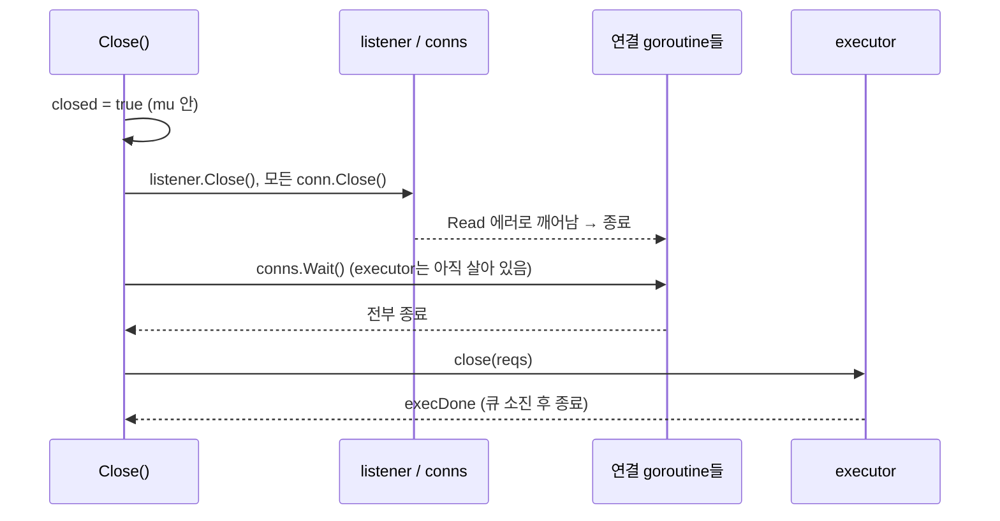
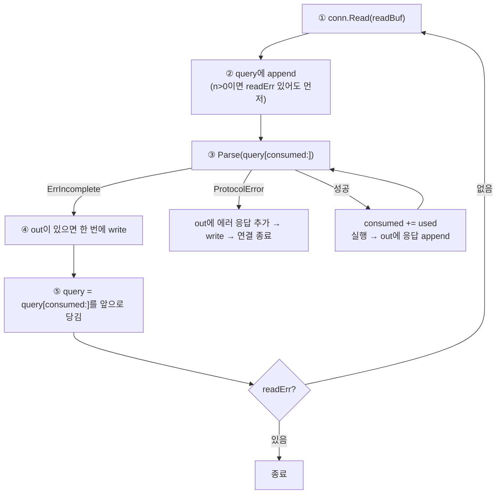

# Server `Close()` 종료 순서 & `handleConn` query buffer 처리 — 중간 요약

- **작성일**: 2026-10-25
- **구분**: 중간 요약 (Phase 1-3 완료 시점)
- **근거 코드**: `internal/network/server.go`, `internal/network/server_test.go`, `internal/protocol/parser.go`

## 1. 상황 및 배경

- **목표**: Phase 1-3 — conn당 goroutine + **단일 executor goroutine**으로 명령을 직렬화하는 TCP 서버 구현 (`docs/2026-10-25-redis-implementation-plan.md` 1-3).
- 구현하면서 풀어야 했던 두 가지 설계 문제:
  1. goroutine 여러 개가 얽힌 서버를 **누수·panic·데드락 없이 종료**하는 순서
  2. TCP **스트림**에서 명령 경계를 찾기 위한 **query buffer** 처리 (부분 수신, pipeline)
- 두 문제 모두 이후 단계(pipeline, event loop 교체)의 기반이 된다.

## 2. 원인 분석 (설계상 위험 지점)

| # | 위험 | 발생 조건 | 결과 |
|---|------|-----------|------|
| R1 | 닫힌 채널에 send | executor 종료 신호(`close(reqs)`)를 연결 goroutine보다 먼저 보냄 | **panic** |
| R2 | executor가 먼저 종료 | 연결 goroutine이 `<-replyCh`에서 응답 대기 중 | `conns.Wait()` **데드락** |
| R3 | 유휴 연결의 `Read` 블로킹 | `Close()`가 연결을 닫지 않음 | goroutine **누수**, `Wait()` 영원히 대기 |
| R4 | `WaitGroup.Add`와 `Wait`의 경합 | `Close()` 중 새 연결 accept | 정의되지 않은 동작 |
| R5 | 반쪽 메시지 유실 | `Parse` 실패 시 버퍼를 비우거나 소비 | 명령 손상 |
| R6 | 읽기 데이터와 에러 동시 반환 | `n > 0`이면서 `err != nil`(EOF) | 이미 도착한 명령 누락 |
| R7 | 응답마다 write | pipeline 명령 N개에 write N번 | 시스템콜 낭비 |
| R8 | 버퍼 무한 증가 | 처리한 앞부분을 제거하지 않거나 상한 없음 | 메모리 증가 (**상한은 미해결**) |

## 3. 해결 과정 (History)

1. **구조 합의**: 연결 goroutine = 읽기·파싱·응답 write, executor = 실행. `network`는 `Handler` 인터페이스에만 의존해 1-4와 분리 (계획서의 의존 방향 유지).
2. **TDD Red**: `server_test.go` 7개 테스트 작성, 컴파일 실패 확인.
3. **구현 (Green)**: `server.go` 작성. `-race -count=30` 반복 통과.
4. **Q&A 1 — `Close()` 순서의 이유** 설명 → 아래 4-1.
5. **Q&A 2 — query buffer 처리 흐름** 설명 → 아래 4-2.
6. **query buffer 상한 부재**를 README 미해결 항목으로 승격.

## 4. 최종 결론 및 반영 코드

### 4-1. `Close()` 종료 순서

**원칙: 생산자(연결 goroutine) → 채널 close → 소비자(executor) 순으로 정리한다.**



| 단계 | 동작 | 이 순서여야 하는 이유 |
|------|------|----------------------|
| 1 | `closed=true`, listener·연결 닫기 | 새 연결 차단(R4), 유휴 `Read` 깨우기(R3) |
| 2 | `conns.Wait()` | send할 주체 소멸 확정. **executor는 살려 둠**(R2) |
| 3 | `close(reqs)` | 보내는 쪽이 없을 때만 안전(R1) |
| 4 | `<-execDone` | `Close()` 반환 시 모든 goroutine 정리 보장. 테스트가 락 없이 `counter`를 읽어도 되는 근거 |

보조 장치: `closeOne sync.Once`(중복 호출 안전), `track()`이 `mu` 안에서 `closed` 확인 후 `Add`(R4), `Serve`가 `Close`보다 늦게 시작해도 listener를 닫고 반환.

```go
// internal/network/server.go
func (s *Server) Close() error {
	s.closeOne.Do(func() {
		s.mu.Lock()
		s.closed = true
		if s.listener != nil {
			s.listener.Close()
		}
		for conn := range s.active {
			conn.Close()
		}
		s.mu.Unlock()

		s.conns.Wait()
		close(s.reqs) // 연결 goroutine 이 모두 끝난 뒤에만 닫아야 send-on-closed 가 없다
		<-s.execDone
	})
	return nil
}
```

### 4-2. `handleConn` query buffer 처리 순서



| 단계 | 동작 | 해결하는 위험 |
|------|------|---------------|
| ① ② | `readBuf`(임시)와 `query`(연결 수명)를 분리, 읽은 만큼 `query`에 이어 붙임 | 스트림 경계 없음 |
| ② | `n>0`이면 `readErr`보다 데이터를 먼저 처리, 에러는 루프 끝에서 판단 | R6 |
| ③ | `consumed` 오프셋만 전진, `ErrIncomplete`면 버퍼를 건드리지 않고 이탈 | R5 (반쪽 보존), pipeline 다중 명령 |
| ④ | 한 번 읽은 명령들의 응답을 모아 write 1회 | R7 (Phase 5-1 pipeline 기반) |
| ⑤ | 처리한 앞부분 제거, 남은 반쪽만 앞으로 이동 | R8 일부 (재할당 없이 재사용) |

```go
// internal/network/server.go (handleConn 핵심부)
for {
	n, readErr := conn.Read(readBuf)
	query = append(query, readBuf[:n]...)

	consumed := 0
	for {
		v, used, err := protocol.Parse(query[consumed:])
		if errors.Is(err, protocol.ErrIncomplete) {
			break
		}
		if err != nil {
			out = protocol.Append(out, errorReply("Protocol error: "+protoMsg(err)))
			conn.Write(out)
			return
		}
		consumed += used
		// ... toArgs, 빈 명령 무시, s.reqs <- request{...}, out = Append(out, <-replyCh)
	}

	if len(out) > 0 {
		if _, err := conn.Write(out); err != nil {
			return
		}
		out = out[:0]
	}
	query = append(query[:0], query[consumed:]...)

	if readErr != nil {
		return
	}
}
```

### 4-3. 테스트로 입증된 항목

| 테스트 | 입증 내용 |
|--------|-----------|
| `FragmentedCommand` | 1바이트씩 쪼개 보내도 처리 (R5) |
| `PipelinedCommands` | 한 번에 3명령 → 순서대로 응답 (R7) |
| `ProtocolErrorClosesConnection`, `RejectsNonBulkArrayElements` | 에러 응답 후 연결 종료 |
| `SingleExecutorSerializesCommands` | 100 클라이언트 × 50 명령, 락 없는 handler로 `-race` 통과 + 합계 5000 |
| `CloseDisconnectsIdleClients` | 유휴 연결이 있어도 `Close()` 반환 (R3) |

## 5. 주의 사항 및 Next Step

### 미해결 / 잠재 리스크

| 항목 | 내용 | 대응 |
|------|------|------|
| ⚠️ **query buffer 상한 없음** | 큰 bulk 길이만 선언하고 천천히 보내면 메모리 증가 (R8). Redis는 `client-query-buffer-limit`(기본 1GB)로 차단 | 상한 초과 시 `-ERR` 후 연결 종료 + 테스트. 1-4와 함께 또는 Phase 5-1 전 |
| ⚠️ 재파싱 비용 | 큰 bulk가 조각으로 오면 `Read`마다 처음부터 재파싱, O(k × 크기). Redis는 `bulklen`을 기억 | Phase 5 벤치마크로 측정 후 결정 |
| ⚠️ Handler panic | executor가 죽으면 연결 goroutine들이 `<-replyCh`에서 멈추고 `Close()`도 반환 불가 | 1-4에서 recover 방식 결정 |
| ⚠️ graceful shutdown 아님 | 연결부터 끊으므로 처리 중이던 응답은 유실 가능 | Phase 4 (AOF 종료 시 fsync) 때 재설계 |
| 복사 2~3회 | 소켓 → `readBuf` → `query` → `Parse`의 `Str` | 벤치마크 후 최적화 |
| `New`가 goroutine 시작 | `Close()` 미호출 시 누수 | 주석으로 명시됨 |

### Next Step

1. **1-4 + 1-5 통합 진행** (command table/dispatcher + in-memory store). Handler panic 복구, 에러 응답의 CR/LF 처리도 함께 결정.
2. query buffer 상한 구현(테스트 선행).
3. 1-4 완료 시점에 `brew install redis`로 `redis-cli`, `redis-benchmark` 설치 후 Phase 1 완료 기준 검증.
