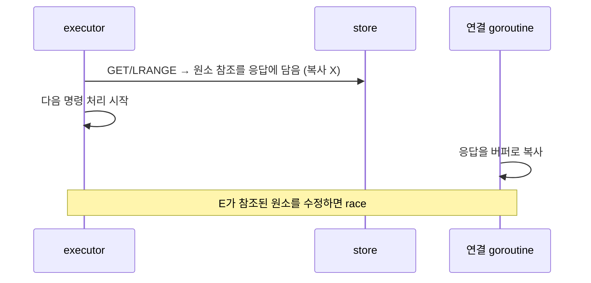

# 제자리 수정 금지 불변식 정리 및 List 구현 검증 (최종 요약)

> 작성일: 2026-11-09 / 코드 변경 없음 (읽기 전용 검증). 대상: `internal/command/list.go`, `internal/store/db.go`, `internal/command/list_test.go`

## 1. 상황 및 배경

- `README.md`의 "`Object.Str`과 동일하게 List 슬라이스도 제자리 수정 금지" 문구가 정확히 무엇을 뜻하는지 확인하는 질문에서 시작했다.

## 2. 원인 분석 (규칙이 생긴 이유)

근거: `docs/summary/20261101-command-dispatcher-and-store-summary.md:24`

- 응답 `Value`가 store의 바이트 슬라이스를 **복사 없이 참조**한다. `bulk()`는 `protocol.Value{Kind: BulkString, Str: b}`로 `b`를 그대로 담는다 (`internal/command/dispatcher.go:255-257`).
- 응답을 복사하는 쪽은 **연결 goroutine**이고, 그 시점에 **executor는 이미 다음 명령을 처리 중**이다.
- executor가 응답이 참조하는 배열을 수정하면 data race가 된다.
- 규칙의 정확한 의미: **store에 들어간 슬라이스의 백킹 배열 내용을 직접 덮어쓰지 말고, 새 슬라이스(또는 재슬라이싱)로 교체한다.**

## 3. 최종 결론 (검증 결과)

### 3-1. `append` cap 함정 → 안전 (구조적 근거 확인)

| 위치 | 동작 | 판단 |
|---|---|---|
| `LPUSH` (`list.go:43-47`) | `make`로 새 슬라이스를 만들고 `cur`를 복사 | 기존 배열 불변 |
| `RPUSH` (`list.go:49`) | `append(cur, vals...)`. cap이 남으면 기존 배열 `len` 뒤 칸에 씀 | 아래 이유로 안전 |
| `LPOP`/`RPOP` (`list.go:149`, `154`) | `list[n:]`, `list[:len-n]` 재슬라이싱 | 기존 배열 불변 |

`RPUSH`가 안전한 이유:

- 응답에 나가는 것은 **바깥 `[][]byte`가 아니라 원소 `[]byte`** 뿐이다 (`bulk(list[i])`, `list.go:97`, `147`, `152`). `bulk()`가 복사하지 않는다는 것도 확인했다.
- 원소는 불변이라고 `db.go`에 명시돼 있다 (`Elements are immutable`).
- 따라서 `RPOP` 후 `RPUSH`가 같은 바깥 배열 칸을 덮어써도, 이미 응답에 담긴 원소 포인터는 바뀌지 않는다.

### 3-2. `LRANGE` 응답 방식 → 규칙 준수

- `elems`를 새로 만들고 원소만 담는다 (`list.go:79`, `96-98`). 슬라이스 자체를 넘기지 않는다.
- 음수 인덱스·범위 클램핑 처리 (`list.go:84-95`). `start >= n`이면 `stop`이 `n-1`로 잘려 루프가 돌지 않는다.
- README에는 실제 `redis-server` 8.10.3과 49개 명령 대조 결과가 전부 일치했다고 기록돼 있다. 이 문서 작성자가 직접 재현한 것은 아니다.

### 3-3. 불변식 강제 장치 → 주석 + 값 검증 테스트 1건

- 주석: `db.go`의 `Str`, `List` 필드.
- 테스트: `TestList_ReplyUnaffectedByLaterCommands` (`list_test.go:131-142`)가 `LRANGE` 응답 이후 `LPOP`/`LPUSH`/`RPUSH`를 실행해도 응답 원소가 안 변하는지 확인한다.
- 한계:
  - 단일 goroutine에서 값만 비교하므로 race detector에 의존하지 않는다.
  - `RPOP` 후 `RPUSH`로 바깥 배열 칸을 덮어쓰는 경로는 이 테스트가 직접 다루지 않는다.
  - 규칙 위반을 컴파일 단계에서 막는 장치는 여전히 없다.

## 4. 주의 사항 및 Next Step

- **설계 의존성**: 안전성은 "바깥 슬라이스는 executor 안에서만 쓰고, 응답에는 불변 원소만 내보낸다"는 약속에 기댄다. 나중에 `LRANGE` 등이 바깥 슬라이스 조각을 그대로 응답에 넣도록 바뀌면 `RPUSH`의 `append`가 위험해진다. 새 타입(Hash/Set/ZSet) 추가 시에도 같은 기준으로 확인한다.
- **메모리 유지**: README는 `LPOP` 재슬라이싱이 앞쪽 원소를 붙잡는다고만 적었다. `RPOP`(`list[:len-n]`)도 뒤쪽 원소 참조가 backing array에 남는다. 문서에 한 줄 추가를 검토한다 (수정 필수는 아님).
- **Next Step**
  1. `RPOP` 후 `RPUSH` 경로를 포함하도록 불변식 테스트 확장 검토.
  2. 핵심 조건("응답에는 원소만 담는다")을 `list.go` 또는 `db.go` 주석에 명시할지 검토.
